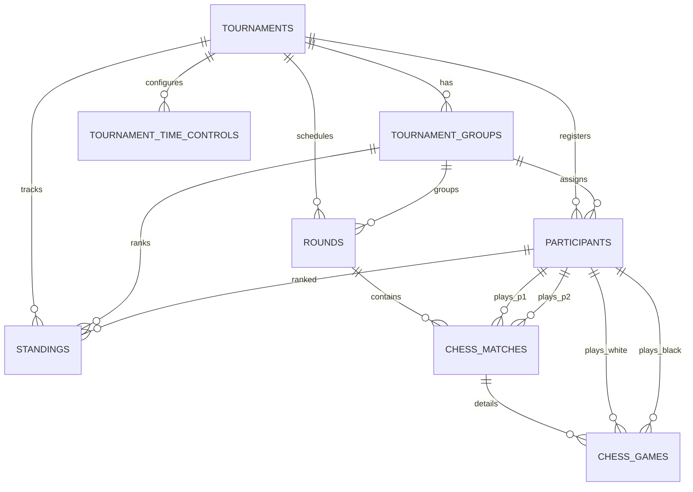

# System Architecture

## 1. Architectural Style
Hệ thống tuân theo kiến trúc **Domain-Driven Service Layer** kết hợp **Full-stack Reactive UI** với Laravel 11 và Livewire 3:

```
┌────────────────────────────────────────────────────────┐
│                   Livewire UI Layer                    │
│   • SetupWizard (Cấu hình giải & bảng & time controls) │
│   • MatchBoard (Hiển thị cặp đấu, Accordion ván)       │
│   • StandingsBoard (Bảng xếp hạng theo bảng)           │
└───────────────────────────┬────────────────────────────┘
                            │
                            ▼
┌────────────────────────────────────────────────────────┐
│                     Service Layer                      │
│   • RoundRobinSchedulerService (Xoay vòng Berger)      │
│   • SwissSchedulerService (Ghép cặp Thụy Sĩ)           │
│   • StandingsCalculatorService (Tính điểm & Tie-break) │
│   • MatchGameFactory (Tạo match + game + đảo màu)      │
└───────────────────────────┬────────────────────────────┘
                            │
                            ▼
┌────────────────────────────────────────────────────────┐
│               Data Layer (Eloquent ORM)                │
│   Tournaments ── Groups ── Participants ── Standings   │
│        └── TimeControls ── Rounds ── Matches ── Games  │
└────────────────────────────────────────────────────────┘
```

## 2. Entity Relationship Diagram (ERD)



## 3. Data Integrity & State Machine
- **Trạng thái Trận đấu (`ChessMatch.status`)**:
  - `pending`: Đang chờ thi đấu hoặc đang ghi điểm ván.
  - `completed`: Đã bấm tích xanh xác nhận $\rightarrow$ Khóa chỉnh sửa.
- **Trạng thái Ván đấu (`ChessGame.result`)**:
  - `null`: Chưa thi đấu.
  - `'1-0'`: Trắng thắng (P1 hoặc P2 tùy vị trí cầm quân).
  - `'0.5-0.5'`: Hòa (mỗi bên 0.5đ).
  - `'0-1'`: Đen thắng.
- **Quy tắc tính điểm**:
  - `ChessMatch.player1_score` = $\sum$ điểm Player 1 trong các ván con.
  - `ChessMatch.player2_score` = $\sum$ điểm Player 2 trong các ván con.
  - Khi `ChessMatch.status` đổi sang `completed`, Event `MatchResultConfirmed` kích hoạt `StandingsCalculatorService` tính toán lại toàn bộ bảng xếp hạng của bảng đó trong Transaction.
